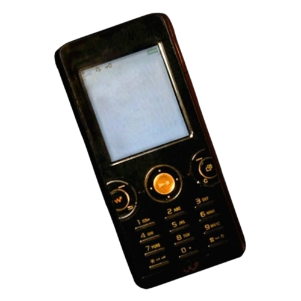
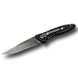
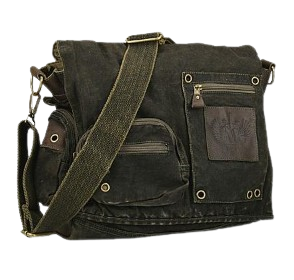

<a href="https://git.io/typing-svg" align="center">

> [!CAUTION]
TW . sensitive topics. view at your own risk.

  
    
  

 INTRODUCTION 

$${\color{#64615A} \space "Ive \space always \space felt \space alone \space my \space whole \space life,}$$
$${\color{#64615A} \space for \space as \space long \space as \space I \space can \space remember. \space I \space \space dont \space know}$$
$${\color{#584f42} \space if \space I \space like \space it \space . \space . \space . \space or \space if \space Im \space just \space used}$$
$${\color{#584f42} \space to \space it, \space but \space I \space do \space know \space this: \space Being \space lonely \space does}$$
$${\color{#4a4236} \space things \space to \space you, \space and \space feeling \space shit \space and \space bitter \space and \space angry}$$
$${\color{#4a4236} \space all \space the \space time \space just \space . \space . \space . \space eats \space away \space at \space you."}$$

 

 Username: ? Password: ? 

$${\color{#64615A} \space marriage \space in \space april \space - \space excelsior}$$
$${\color{#64615A} | \space ??? \space / \space May \space / \space 2007 \space † }$$
$${\color{#64615A} \space MDNI }$$

 

 "Dear diary." 

$${\color{#DA3633} "The \space pills \space showed \space me \space the \space truth \space today, \space they \space always \space did.}$$
$${\color{#DA3633} They \space opened \space my \space eyes, \space they \space \space gave \space me \space wisdom, \space and \space I \space acted \space upon \space it." }$$
$${\color{#a72222} "Oh \space I \space wish \space I \space couldve \space \space taken \space everybody \space with \space me,}$$
$${\color{#a72222} but \space unfortunately, \space my \space . \space . \space . \space situation \space makes \space that \space impossible."}$$
$${\color{#862e1f} "To \space whoever \space is \space reading \space this: \space I \space hope \space my \space dead \space body \space will \space haunt \space you \space forever.}$$
$${\color{#862e1f} Have \space fun \space scraping \space my \space brains \space off \space the \space walls."}$$
$${\color{#28241c} "Fuck \space you."}$$
$${\color{#433b2c} . \space}$$
$${\color{#433b2c} . \space}$$
$${\color{#433b2c} . \space}$$

 

</a>
 

 

>
